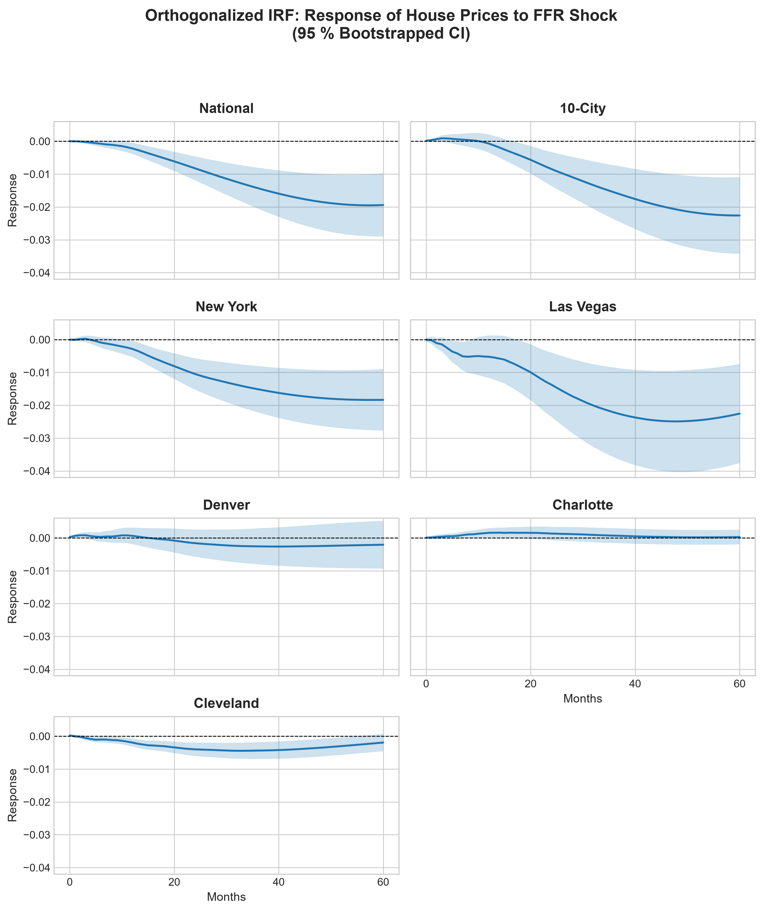
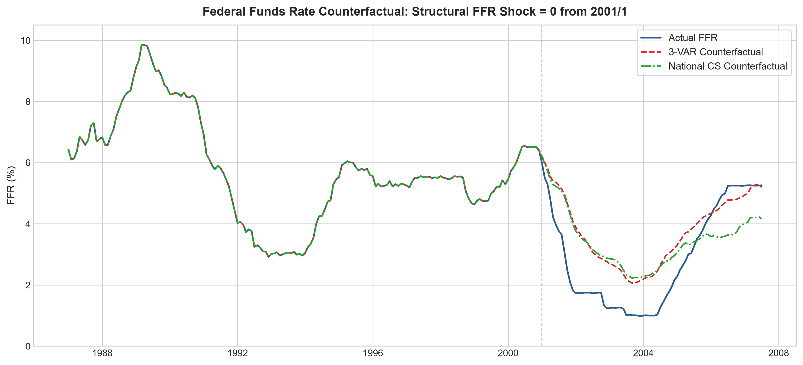

# Monetary Policy and the 2007 US Housing Bubble

**A Structural Vector Autoregressive Analysis in Python, cross-validated against Stata 19**

> Aitola, T. (2026). *Monetary Policy and the 2007 US Housing Bubble: A Structural Vector Autoregressive Analysis*. Master's Thesis in Economics, Tampere University.

From 2001 to 2004 the Federal Reserve held the federal funds rate (FFR) well below the level its own Taylor rule-type reaction to unemployment and inflation would have implied. Did that easy money inflate the US housing bubble? This repository answers the question with structural VARs estimated on monthly data from 1987/01 to 2007/07, for two national Case-Shiller indices and five metropolitan areas with very different housing supply elasticities. The answer depends on where you look. Nationally and in supply-constrained New York, monetary policy shocks were followed by house price changes of around 2%, and without the post-2001 shocks the national price peak would have been about 17% lower. In elastic markets such as Charlotte and Denver, new construction absorbed the extra demand and prices barely moved.

**[Read the full walkthrough in `thesis_analysis.ipynb`](thesis_analysis.ipynb)**, with equations, figures and interpretation.

## Key Findings

### House prices respond to monetary policy shocks



Each panel shows how log house prices respond over five years to a one standard deviation, roughly 12 basis point, monetary policy shock, with 95% bootstrapped bands. The model is linear, so an easing shock of the same size moves prices by the same amount in the opposite direction. Nationally, prices move by almost 2% after four to five years, and the 10-City index (2.3%), New York (1.8%) and Las Vegas (2.5%) respond similarly. In supply-elastic Charlotte and Denver the response is never significantly different from zero, and in Cleveland it is small, at 0.4%.

### The Fed held rates below its Taylor rule from 2001



The counterfactual removes all monetary policy shocks from 2001/01 onward, so the FFR follows only the Fed's estimated systematic reaction to unemployment and inflation. The actual rate ran 1.2–1.6 percentage points below this Taylor rule baseline on average in each year from 2002 to 2004, and up to 2.2 points below it. A 3-variable model without house prices gives almost the same baseline through 2004, so the gap does not come from including housing in the model.

Feeding the baseline rate through each model shows what this deviation did to prices. Without the shocks, peak house prices would have been 17% lower nationally, 20% lower in the 10-City index, 17% lower in New York and 19% lower in Las Vegas. Las Vegas still keeps its sharp mid-2003 acceleration, which points to the private-label mortgage credit boom and speculation rather than the interest rate alone. Charlotte, Denver and Cleveland change by 3.5% or less. All seven paths are shown in [Figure 23](figures/fig23_counterfactual_grid.png).

## Methodology & Stata 19 Cross-Validation

**Model.** Each series has its own reduced-form VAR(12) in levels with $y_t = [\text{unemp}_t, \text{pce}_t, \text{ffr}_t, \log(\text{hpi}_t)]'$, following Kilian & Lütkepohl (2017). With 247 monthly observations and 12 lags, the effective sample is $T = 235$.

**Identification.** A recursive Cholesky ordering embeds a backward-looking Taylor Rule. The Fed responds within the month to unemployment and inflation, those variables respond to policy with a lag, and house prices respond immediately to all three.

**Counterfactual.** The simulation sets the structural policy shock to zero from 2001/01 and recursively rebuilds each series in-sample, following Kilian & Lütkepohl (2017, p. 120).

**Replicating Stata in Python.** [`src/var_irf.py`](src/var_irf.py) reproduces two Stata defaults that differ from `statsmodels`:

- **ML covariance scaling.** `statsmodels` divides the residual covariance by $T - Kp - 1$, and Stata's `var` divides by $T$. The code multiplies the Cholesky factor by $\sqrt{(T - Kp - 1)/T} = \sqrt{186/235} \approx 0.88966$.
- **Residual bootstrap.** The code implements the algorithm in Stata's *[TS] irf create* manual: 500 replications that condition on the presample, resample residual vectors, simulate recursively, re-estimate, and take the sample standard deviation across replications.

NumPy and Stata use different random number generators, so bootstrap standard errors match Stata up to Monte Carlo error rather than digit for digit.

## Repository Structure

```
.
├── thesis_analysis.ipynb    # Narrative walkthrough with equations, figures and results
├── data_csv/
│   ├── var_data.csv         # Model data, 1987/01–2007/07
│   └── visual_data.csv      # Exploratory data, 1959/01–2025/08
├── src/
│   ├── config.py            # Paths, sample periods, FRED tickers and model settings
│   ├── fred_download.py     # Optional data refresh from FRED
│   ├── data_processing.py   # Loading, log transforms and permits per capita
│   ├── var_irf.py           # VAR estimation and Stata-compatible bootstrapped IRFs
│   ├── counterfactual.py    # Counterfactual simulation with policy shocks set to zero
│   └── plots.py             # All figures, with optional saving at 300 dpi
├── requirements.txt
└── LICENSE
```

## Quickstart

`data_csv/var_data.csv` and `data_csv/visual_data.csv` are tracked in this repository, so you can clone, install and run the notebook immediately **without an API key**.

```bash
git clone <repository-url>
cd msc-thesis-data-platform
python -m venv .venv
source .venv/bin/activate   # On Windows: .venv\Scripts\activate
pip install -r requirements.txt
```

Open `thesis_analysis.ipynb` in VS Code with the Jupyter extension, select the `.venv` kernel and run all cells. The full notebook, including 3,500 bootstrap VAR estimations, takes about a minute on a typical laptop. The bootstrap uses a fixed seed, so repeated runs give the same results.

**Optional: fetch live data from FRED.** Create a `.env` file in the project root with your [FRED API key](https://fred.stlouisfed.org/docs/api/api_key.html), then set `REFRESH_DATA = True` in the notebook. This overwrites the CSV files, and later data revisions on FRED can change the results.

```
FRED_API_KEY=your_api_key_here
```

## License

Released under the [MIT License](LICENSE).
